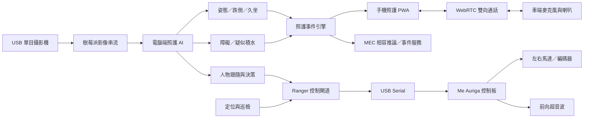

# 智護隨行

## 結合人工智慧視覺與自主巡檢之高齡者居家照護機器人


「智護隨行」是一套以 **mBot Ranger、樹莓派、單目 USB 攝影機與電腦端 AI** 組成的高齡者居家照護原型。系統希望改善固定攝影機視野有限、照護人力不足，以及異常事件無法立即送達家屬等問題，讓移動式機器人主動進入不同生活空間進行觀察、巡檢與通報。

本專案整合人體姿態估計、跌倒與久坐判斷、環境風險篩檢、人物跟隨、輪式里程計、局部地圖、自主巡檢、語音陪伴、手機照護平台及 MEC 相容通訊架構。設計重點不是單一 AI 模型，而是把感知、決策、移動、互動及遠距照護串成可操作、可測試的端到端系統。

> 本作品目前為研究與競賽用原型，不是醫療器材，也不能取代照護人員、醫療判斷或緊急救援服務。

## 核心特色

### 人體姿態與主動式安全監測

- 使用 MediaPipe Pose 擷取人體關鍵點與骨架。
- 支援全身及上半身觀察，改善低角度攝影機無法持續看見腳踝與膝蓋的問題。
- 結合連續影格、軀幹角度、身體下降、姿態持續時間及追蹤中斷判斷疑似跌倒。
- 區分站立、坐姿、彎腰、臥躺及休息區正常躺臥。
- 提供久坐、久未移動及徘徊監測。
- 跌倒後先語音詢問長者；若未取消、未重新站起或回覆高風險語句，再升級通知。

### 移動機器人與安全控制

- 控制 mBot Ranger 前進、後退、左轉、右轉及停止。
- 讀取左右輪編碼器、RPM、移動狀態與前向超音波距離。
- 透過 `DONE:<command>` 確認控制板完成指令流程。
- 定位、感測或網路狀態異常時，優先送出停止指令。
- 巡檢實車模式預設鎖定馬達輸出，必須明確加入 `--enable-motion` 才會移動。

### 定位、地圖與自主巡檢

- 以左右輪編碼器建立差速／履帶式里程計。
- 建立局部占用地圖，提供超音波障礙資訊與定位可信度。
- 使用單目特徵追蹤與起點候選迴環輔助定位分析。
- 支援巡檢點、停車觀察、任務暫停／恢復、取消及緊急停止。
- 定位失敗或找不到安全路徑時停止任務，不繼續盲走。

### 遠距照護與語音互動

- 手機端採 PWA，可顯示高風險警示、最近照護事件及藥品紀錄。
- 管理員、照護者與唯讀帳號具有不同權限。
- 支援 Gemini 對話、麥克風收音及車上喇叭語音輸出。
- 支援 WebRTC 手機與車端雙向通話、配對金鑰、忙線與逾時處理。
- 提供正常影像模式與隱私骨架模式切換。

### Edge／MEC 相容架構

- Edge Agent 傳送取樣影像並接收遠端推論結果。
- 網路失效時維持本地安全推論，不讓遠端服務阻塞急停或照護判斷。
- 異常事件可寫入本機 outbox，恢復連線後依序補送並避免重複事件。
- 提供容器、健康檢查、延遲統計、故障注入與平台契約模擬器。

## 系統架構



## 硬體組成

| 元件 | 用途／目前設定 |
| --- | --- |
| mBot Ranger／Me Auriga | 履帶式移動平台與馬達控制 |
| Raspberry Pi／Linux | 攝影機串流、Ranger 閘道與車端音訊 |
| icSpring USB Camera | 單目 RGB 影像；裝車鏡頭中心約離地 14 cm |
| Ranger 編碼馬達 | 左右輪脈衝、RPM 與里程計 |
| 前向超音波 | 約離地 10 cm，提供近距離緊急障礙判斷 |
| AB13X USB Audio | 車端麥克風，ALSA `hw:3,0` |
| CD002-AUDIO | 車端喇叭，ALSA `plughw:2,0` |
| Windows 電腦 | AI 推論、網頁、定位、巡檢及 MEC 測試 |

已記錄車體參數包含：車寬約 15.5 cm、車長約 20.5 cm、左右驅動輪中心距約 14.5 cm、輪胎外徑約 6 cm。履帶轉向容易打滑，因此程式保留左右獨立校正係數，不能只依理論輪距推算角度。

## 軟體技術

| 類別 | 技術 |
| --- | --- |
| 影像處理 | OpenCV、MJPEG、相機校正 |
| 人體感知 | MediaPipe Pose、連續影格狀態機 |
| 物件／深度 | YOLO、Depth Anything V2 |
| 後端服務 | Python、Flask、REST API、SQLite |
| 車體通訊 | USB Serial、9600 baud、自訂 `TEL`／`DONE` 協定 |
| 定位導航 | 輪式里程計、局部占用地圖、視覺特徵追蹤、巡檢任務狀態機 |
| 手機端 | Responsive Web、PWA、Service Worker、Web Push 架構 |
| 即時音訊 | WebRTC、瀏覽器回音消除與降噪 |
| AI 對話 | Gemini API、語音輸入與 TTS 輸出 |
| Edge／MEC | HTTP API、事件 outbox、Docker、延遲分位數統計 |
| 遠端連線 | HTTPS／Tailscale；跨網路通話可配置 STUN／TURN |

目前程式採 Python／Flask 模組化服務，**尚未轉換成正式 ROS2 節點**。文件或展示時請勿將本專案描述成已完成 ROS2 Navigation Stack 整合。

## 已完成的實測

| 測試 | 結果 | 說明 |
| --- | --- | --- |
| 照護姿態畫面 | 約 16.1–21.7 FPS | 不同畫面與硬體負載下的觀察值 |
| 舊版 YOLO 推論 | 約 220–340 ms／張 | 電腦端紀錄 |
| Depth Anything V2 | 約 1.45–1.55 s／張 | 電腦端紀錄，速度不足以逐影格執行 |
| 本機 MEC 基準 | 50/50 張成功 | RTT p50 78 ms、p95 94 ms、p99 109 ms |
| 本機穩態 MEC | 106/106 張成功 | RTT p50 63 ms、p95 79 ms、p99 79 ms |
| 模擬中途斷線 | 60/60 張維持本地推論 | 遠端成功 40 張，連線恢復後回到 online |
| Ranger 遙測 | 已收到 pulse、RPM、`front_cm` | 已確認超音波可回傳實際距離 |
| 實車控制 | 已測前後、左右轉及停止 | 已修正左右方向與轉向力道差異 |

以上 MEC 數據來自同一台電腦或本機網路的相容架構測試，**不是中華電信正式 5G MEC 延遲**。跌倒辨識目前也尚未累積足夠標註樣本，因此不提供未經驗證的準確率數字。

## 專案目錄

```text
dogdoctor-care-platform/
├─ homecloud/
│  ├─ eldertest/                 # 姿態、跌倒、久坐、語音與環境安全
│  ├─ navigation/                # 里程計、地圖、定位與巡檢
│  ├─ firmware/                  # Me Auriga／Ranger 韌體
│  ├─ deploy/                    # Edge、MEC 與服務部署範例
│  ├─ tests/                     # 照護、導航、MEC、音訊等測試
│  ├─ run_homecare.py            # 照護監測入口
│  ├─ ranger_gateway.py          # Ranger 車端控制閘道
│  ├─ run_localization.py        # 即時定位服務
│  ├─ run_real_patrol.py         # 實車自主巡檢
│  └─ mec_service.py             # MEC 相容服務
├─ guardian_mobile/
│  ├─ guardian/                  # PWA、事件、用藥、通知與 WebRTC
│  └─ run_guardian.py            # 手機照護平台入口
├─ 執行交付說明.md
├─ 目前未完成項目.md
└─ SECURITY.md
```

## 快速開始

### 1. 電腦端照護監測

```powershell
cd homecloud
py -m venv .venv
.\.venv\Scripts\Activate.ps1
python -m pip install -r requirements-care.txt
Copy-Item .env.example .env
python run_homecare.py --source 0 --port 5002 --local-tts
```

開啟 `http://127.0.0.1:5002/care`。若使用樹莓派 MJPEG 串流，將 `--source 0` 改為：

```powershell
python run_homecare.py `
  --source "http://樹莓派IP:5001/video_feed" `
  --port 5002 --local-tts
```

### 2. Ranger 車端閘道

在樹莓派接上已燒錄對應韌體的 Me Auriga 後執行：

```bash
python3 ranger_gateway.py --port /dev/ttyUSB0 --baud 9600
```

健康檢查：`http://樹莓派IP:5000/health`

### 3. 即時定位與實車巡檢

```powershell
python run_localization.py --robot-ip 樹莓派IP --port 5005
python run_real_patrol.py --robot-ip 樹莓派IP --port 5007
```

- 定位頁：`http://127.0.0.1:5005/localization`
- 巡檢頁：`http://127.0.0.1:5007/real-patrol`

實車巡檢預設不會驅動馬達。請先架空車輪確認方向、執行前置檢查、清空測試區域並準備實體急停，才加入 `--enable-motion`。

### 4. 手機照護平台

```powershell
cd guardian_mobile
py -m venv .venv
.\.venv\Scripts\Activate.ps1
python -m pip install -r requirements.txt
python run_guardian.py --host 0.0.0.0 --port 5006
```

手機安裝、HTTPS、推播、Gemini、Tailscale 與車端通話請參考：

- [手機 App 與通知設定](guardian_mobile/手機App與通知設定.md)
- [車端雙向通話設定](guardian_mobile/車端雙向通話設定.md)
- [Gemini 設定](guardian_mobile/Gemini設定.md)

## 模型與設定檔

GitHub 不保存模型權重及大型 TFDA XML 資料。執行完整功能前，請依設定放入：

```text
homecloud/models/best.pt
homecloud/models/best02.pt
homecloud/models/depth_anything_v2_vits.pth
```

從 `.env.example` 建立 `.env`，填寫自己的攝影機、Ranger、Gemini、通知及 MEC 設定。請勿將 `.env`、配對金鑰、照護資料或服務憑證提交至 Git。

## 重要文件

- [完整執行交付說明](執行交付說明.md)
- [目前尚未完成的項目](目前未完成項目.md)
- [姿態與異常監測](homecloud/姿態與異常監測使用說明.md)
- [環境安全檢查](homecloud/環境安全檢查使用說明.md)
- [即時定位與建圖](homecloud/即時定位與建圖使用說明.md)
- [實車自主巡檢](homecloud/實車自主巡檢啟動說明.md)
- [5G／MEC 實作規格](homecloud/5G_MEC_實作規格.md)
- [中華電信平台介接](homecloud/中華電信平台介接.md)
- [安全政策](SECURITY.md)

## 目前限制與後續工作

- 擴充跌倒資料，依人物、距離、衣著、光線及遮擋計算召回率、誤報率與警報延遲。
- 將疑似積水規則升級為實際居家資料訓練的語意分割模型。
- 加入瓦斯感測器；漏氣不能只依影像判定。
- 完成全域 pose graph、可靠閉環、長時間漂移修正與任意位置重定位。
- 增加更完整的環境感知；單一前向超音波無法提供 360 度安全範圍。
- 驗證長時間巡檢、低電量、網路中斷、輪胎打滑及移動障礙情境。
- 取得正式端點、SIM、APN 與部署權限後，再進行中華電信 5G／MEC 實網測試。
- 將固定藥品 Demo 擴充為 OCR、TFDA 資料比對、同名異規格消歧及人工確認流程。
- 完成正式推播、簡訊供應商與跨網路 TURN 通話驗收。

## 隱私與安全

- 儲存庫不包含 API 金鑰、LINE 憑證、帳號資料庫、照護事件、私人影片或測試影像。
- 影像與事件資料應設定保存期限，並讓照護對象知道系統何時正在觀察。
- 遠端服務失效時，本地安全控制仍應保有最高優先權。
- 實車測試應先架空車輪，再進行低速、空曠環境及有人監督的地面測試。
- 發現憑證外洩時，應立即在原服務撤銷並重新產生，不只從 Git 歷史刪除。

## 專案狀態

目前已達到「**可展示的實車整合原型**」階段：主要功能可以分別啟動、串接與進行 Demo；定位、巡檢與異常警報已有實車或錄影驗證。距離正式長照場域部署，仍需要更大規模資料驗證、長時間可靠度測試、完整安全機制、正式電信平台資源及個資／維運流程。
