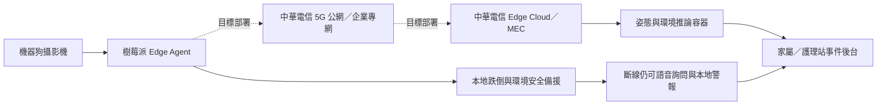

# 銀髮守護犬：中華電信業務關聯性佐證

更新日期：2026-09-12

## 可以在提案中使用的核心說法

> 本作品已完成「中華電信 5G／Edge Cloud／MEC 相容架構」及本機端到端驗證。現階段尚未取得中華電信正式網路與 MEC 測試資源，因此所有延遲數據均標示為本機模擬；取得端點、SIM 與部署權限後，可沿用相同容器、Edge Agent、認證與驗收工具進行場域部署。

這段說法同時表達技術連結與目前限制，不會把預計介接誤寫成已完成。

## 為什麼不是只在計畫書放上「5G」

中華電信的企業專網方案包含 Edge Cloud、專用 MEC、網路切片及本地卸載；官方列出的智慧醫療用途也包含醫療影像傳輸。銀髮守護犬已把這些能力落到可檢查的程式介面：

| 中華電信能力 | 銀髮守護犬中的對應實作 | 現有證據 |
| --- | --- | --- |
| 5G 高上行與移動連線 | 機器狗以 5 FPS JPEG 上傳，保留替換成 H.264／WebRTC 的介面 | 每次測試記錄上傳 bytes 與 Mbps |
| Edge Cloud／MEC | 推論拆成獨立容器服務，可部署到 VM、Docker 或 Kubernetes | `Dockerfile.mec`、Compose、Kubernetes 清單 |
| 低延遲回傳 | 每張影像記錄取像、MEC 處理、RTT 與端到端時間 | p50／p95／p99 JSON 報告 |
| 數位韌性 | MEC 逾時不阻塞本地跌倒偵測；恢復後自動重連 | `edge_recovery_report.json` |
| 資料安全 | Bearer token、TLS 部署規格、裝置隔離、最小化影像上傳 | 未授權請求與不同 device state 測試 |
| 遠端照護 | 警報進入 SQLite 佇列，恢復後依固定 event_id 補送 | 事件送達、重試、平台去重測試 |
| 規模化服務 | 多台機器狗用不同 device_id 共用 MEC | 裝置隔離測試與每裝置推論狀態 |

## 展示架構

圖中實線表示目前已完成的軟體流程；虛線表示需要中華電信資源才能完成的實網部署。

## 三分鐘 Demo 腳本

### 0:00–0:40 正常照護

播放機器狗低視角跌倒影片，展示人體骨架、上半身／全身模式、疑似跌倒、語音詢問與安全小貼士。

### 0:40–1:20 MEC 相容架構

照護頁清楚顯示：

- 目前網路：`本機 Wi-Fi（功能驗證）`
- 部署情境：`中華電信 Edge Cloud／MEC 相容架構（本機模擬）`
- MEC 連線、最近 RTT、待補送事件

說明同一套 HTTPS API、容器與 device_id 可移到正式 MEC，畫面不偽裝成真實 5G。

### 1:20–2:10 斷線韌性

執行故障注入，畫面由「MEC 線上」轉成「MEC 離線／本地備援」。強調跌倒安全判斷仍在機器狗端執行，控制和警報不被遠端超時卡住。

### 2:10–2:40 自動恢復

恢復端點後，狀態自動回到「MEC 線上」，SQLite 待補送事件歸零，後台依相同 `event_id` 去重。

### 2:40–3:00 合作模式

一般家庭採 5G 公網／共享 Edge Cloud 月租服務；長照機構採企業專網＋MEC，多台機器狗共用推論資源。中華電信可提供連線、邊緣算力、資安與企業維運，本團隊提供照護演算法、機器狗與使用者服務。

## 評審可直接檢查的數字

- 本機 MEC 線上：106/106 張成功。
- 本機迴路 RTT：p50 63 ms、p95 79 ms、p99 79 ms。
- 模擬斷線恢復：60/60 張持續執行本地安全推論，最後恢復 `online`。
- 25 秒循環測試：119 張本地推論、3 筆事件全部送達、待補送 0。
- 自動測試：86 項通過。

上述均須冠上「本機模擬／功能驗證」，不能當作真實 5G 延遲。

## 提案用商業合作段落

> 銀髮守護犬可成為中華電信智慧醫療與企業專網的移動 AIoT 終端。一般家庭方案由中華電信行動連線與 Edge Cloud 承載遠端推論、事件傳送及服務維運；長照機構方案則以企業專網與 MEC 在場域內處理照護影像，降低資料離場與網路中斷風險。團隊提供機器人、長照辨識模型與照護流程，中華電信提供 5G 連線、邊緣算力、資安、雲端及企業客戶通路，形成「終端租賃＋連線＋邊緣推論＋照護平台」月租服務。

## 不應使用的說法

- 「已部署中華電信 MEC」
- 「已使用中華電信 5G 專網」
- 「實測達到 5G 超低延遲」
- 「已串接健康雲／IoT 平台」

在正式資源尚未取得時，改用：

- 「中華電信 5G／MEC 相容架構」
- 「已完成本機端到端與斷線韌性驗證」
- 「已備妥容器及實網驗收工具」
- 「取得中華電信端點與權限後即可進行 PoC」

## 官方對應依據

- 2026 大賽智慧醫療主題明列智慧機器人、居家照護、長照 3.0，並強調電信網路與雲端平台資源：https://cht5g.com.tw/index-smart.html
- 中華電信企業專網方案列有共享 Edge Cloud、專用 MEC、切片型架構及智慧醫療影像應用：https://www.cht.com.tw/home/enterprise/products-services/5g/5g-service/712
